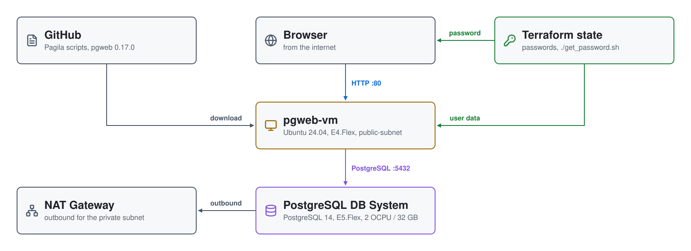

# PostgreSQL on OCI: OCI Database with PostgreSQL and pgweb

A private **OCI Database with PostgreSQL** DB System, built with Terraform
and loaded with the [Pagila](https://github.com/devrimgunduz/pagila) sample
database. The DB System has no public endpoint; a **pgweb** VM in a public
subnet gives you a browser client for it.

| Piece | Where | Role |
|---|---|---|
| **PostgreSQL DB System** | `private-subnet` (10.0.0.0/25) | `postgres-db-system`, PostgreSQL 14, one `PostgreSQL.VM.Standard.E5.Flex` node (2 OCPU, 32 GB), OCI-optimized storage in one availability domain, admin `postgres`; no public endpoint |
| **pgweb-vm** | `public-subnet` (10.0.1.0/25) | Ubuntu 24.04, `VM.Standard.E4.Flex` (1 OCPU, 4 GB); loads Pagila, then serves pgweb 0.17.0 on port 80 |
| **NAT gateway** | `private-subnet` route | outbound internet for the DB System |
| **Internet gateway** | `public-subnet` route | inbound and outbound for the VM |
| **Terraform state** | `01-postgres/terraform.tfstate` | the PostgreSQL and VM passwords, as sensitive outputs; OCI Vault isn't used |

## Architecture

<picture>
  <source media="(prefers-color-scheme: dark)" srcset="architecture-dark.svg">
  
</picture>

Regenerate with `python3 make_diagram.py`.

- **`01-postgres/`** is the whole stack: the VCN (`postgres-vcn`,
  10.0.0.0/23) with its internet and NAT gateways, a route table and security
  list per subnet, the DB System, the SSH key and passwords, and the pgweb
  VM.
- **`01-postgres/data/`** holds the Pagila load scripts (`pagila-db.sql`,
  `pagila-schema.sql`, `pagila-data.sql`) and the sample queries.

## How it boots

1. Terraform builds the VCN, generates an ECDSA SSH key
   (`01-postgres/keys/Private_Key`) and two passwords, and creates the DB
   System.
2. The VM's cloud-init script waits for outbound internet and GitHub, forces
   apt onto IPv4, retries `apt-get update` until the boot-time apt lock
   clears, and opens port 80 in the image's iptables rules, which reject it
   by default. It also sets the `ubuntu` user's password. Progress is in
   `/root/userdata.log`.
3. It installs the PostgreSQL client, clones this repository, and loads
   Pagila into the DB System's private endpoint with `psql`. Output is in
   `/root/db_load.log`.
4. It downloads pgweb 0.17.0 from GitHub and runs it as a systemd service on
   port 80. pgweb starts without a connection; you enter one when you open it.

## Security lists

```
internet ─80, 22─▶ pgweb-vm (public-subnet) ─5432─▶ DB System (private-subnet)
```

| Security list | Subnet | Allows |
|---|---|---|
| `postgres-vm-sl` | `public-subnet` | 80 and 22 from anywhere |
| `postgres-sl` | `private-subnet` | 5432 from `public-subnet` (10.0.1.0/25) only |

Both allow all outbound traffic.

## Prerequisites

* [An OCI Account](https://cloud.oracle.com/)
* [Install OCI CLI](https://docs.oracle.com/en-us/iaas/Content/API/SDKDocs/cliinstall.htm),
  configured with a `DEFAULT` profile in `~/.oci/config`
* [Install Terraform](https://developer.hashicorp.com/terraform/install)
* [Install jq](https://jqlang.github.io/jq/download/)

## Deploy

```bash
git clone https://github.com/mamonaco1973/oci-postgres.git
cd oci-postgres
export OCI_COMPARTMENT_ID=<compartment-ocid>   # optional; defaults to the tenancy
./apply.sh       # one phase: VCN, DB System, pgweb VM
```

Everything deploys to `us-ashburn-1`, in the first availability domain.
`apply.sh` ends by running `validate.sh`, which waits for pgweb to answer (up
to 15 minutes) and prints:

```
================================================================================
BUILD VALIDATION RESULTS
================================================================================
pgweb URL            : http://203.0.113.10
PostgreSQL private IP: 10.0.0.120
Credentials          : ./get_password.sh
================================================================================
```

## Try it

1. Get the passwords:

   ```bash
   ./get_password.sh
   ```

   ```
   PostgreSQL DB System:
     Username : postgres
     Password : <generated>
     Host     : 10.0.0.120 (private)

   pgweb VM:
     Username : ubuntu
     Password : <generated>
     Public IP: 203.0.113.10
     URL      : http://203.0.113.10
   ```

2. Open the pgweb URL and connect with host = the PostgreSQL private IP, port
   `5432`, database `pagila`, user `postgres`, that password, and SSL mode
   `require`.
3. Run the sample queries from the **Query** tab (`01-postgres/data/`):

   ```sql
   SELECT
       f.title AS film_title,
       a.first_name || ' ' || a.last_name AS actor_name
   FROM film f
   JOIN film_actor fa ON f.film_id = fa.film_id
   JOIN actor a ON fa.actor_id = a.actor_id
   ORDER BY f.title, actor_name
   LIMIT 20;
   ```

   ```sql
   SELECT
       f.title,
       STRING_AGG(a.first_name || ' ' || a.last_name, ', ') AS actor_names
   FROM film f
   JOIN film_actor fa ON f.film_id = fa.film_id
   JOIN actor a ON fa.actor_id = a.actor_id
   GROUP BY f.title
   ORDER BY f.title
   LIMIT 10;
   ```

## Troubleshooting

| Symptom | Fix |
|---|---|
| `validate.sh` keeps retrying | The VM is still installing. `ssh -i 01-postgres/keys/Private_Key ubuntu@<public-ip>`, then `sudo tail /root/userdata.log`. |
| The URL times out although pgweb is running | Port 80 must be allowed ahead of the image's REJECT rule: `sudo iptables -L INPUT -n --line-numbers`. |
| `pagila` is missing | Read `/root/db_load.log` on the VM for the `psql` output. |
| pgweb can't connect | Use the private IP from `./get_password.sh` as the host, and set SSL mode to `require`. |
| You want a local client | The DB System is private. Connect from the VM: `psql "host=<private-ip> user=postgres dbname=pagila sslmode=require"`. |

## Teardown

```bash
./destroy.sh     # destroys the whole stack
```

## Notes

- **Lab only.** pgweb is open to the internet over plain HTTP with no
  sign-in of its own and runs as root, SSH is open from anywhere, and the
  passwords are in Terraform state and the VM's user data. Restrict
  `postgres-vm-sl` and add TLS for anything more.
- There's no pgweb screenshot in this repository yet.
